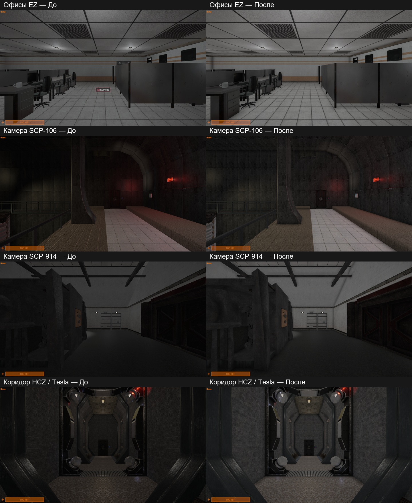

# SCP:SL CE12 — Освещение

[English](README_EN.md) · [Установка](docs/INSTALL_RU.md) · [Компоненты](docs/COMPONENTS.md) · [Проверки](docs/VALIDATION.md)

Отдельный мод принятого освещения для **SCP:SL Community Edition 12.0.2 / Unity6000.3 LTS / Built-in**.

- Более читаемое освещение: фоновая засветка .35 в LCZ/EZ/на поверхности и .50 в HCZ.
- Динамические тени по умолчанию выключены; исправлена штатная кнопка теней и преобразование настройки количества ламп в 6–12 источников на пиксель.
- Восстановлены штатный ключ Ambient Occlusion и режимы Off/MSVO/SAO.
- Настоящие отключения света и особенности зрения ролей сохраняются. Лампы, материалы, геометрия и постэффекты целиком не заменяются.

Это калибровка Built-in, ранее визуально принятая для нашего проекта. Точное совпадение с HDRP новой версии не заявляется. FPS и энергопотребление этим пакетом не гарантируются.

## Скачать и установить

Скачайте **SCPLighting-CE12-1.0.0.unitypackage** со [страницы релиза](https://github.com/Havermeng/scpsl-ce12-lighting/releases), импортируйте полностью через Assets → Import Package → Custom Package. После компиляции откройте **SCP → Mods → Lighting Mod Manager**.

Можно выключить необязательные компоненты и нажать Apply либо удалить мод через Uninstall. Исходники и параметры четырёх файлов восстанавливаются из локальных резервных копий; Unity может нормализовать переводы строк своего YAML пресетов. Ручные изменения после установки не перезаписываются: сначала сохраните их отдельно. После Uninstall можно удалить файлы установщика кнопкой в менеджере.

Сохранённые пользовательские настройки теней/AO имеют приоритет. Если тени были включены раньше, выключите их в штатном меню игры для принятого вида. Установщик не переписывает общую пользовательскую registry.txt. Изменения графических пресетов могут потребовать перезапуска редактора.

Совместим с отдельно устанавливаемыми SCP-939/3114: свой менеджер, namespace, state и backups; файловых пересечений с опубликованными пакетами персонажей нет. Уже вручную изменённые файлы освещения требуют отдельного переноса; конфликтная установка останавливается.

Мод устанавливается в исходный Unity-проект, не в Steam EXE и не в EXILED. Настройки сети, аутентификации, Steam/Central и прочие механики не меняются. Полные проекты игры в этом публичном репозитории отсутствуют.

Сборка: Python3.10+, python tools/build_packages.py; аудит: python tools/audit_packages.py. Обычному пользователю Python/Git не нужны. Подробная приёмка и ограничения — [VALIDATION](docs/VALIDATION.md).

Историческое сравнение из основного проекта, 25 октября 2026. Это иллюстрация принятой калибровки, а не новый полный игровой прогон пакета.
