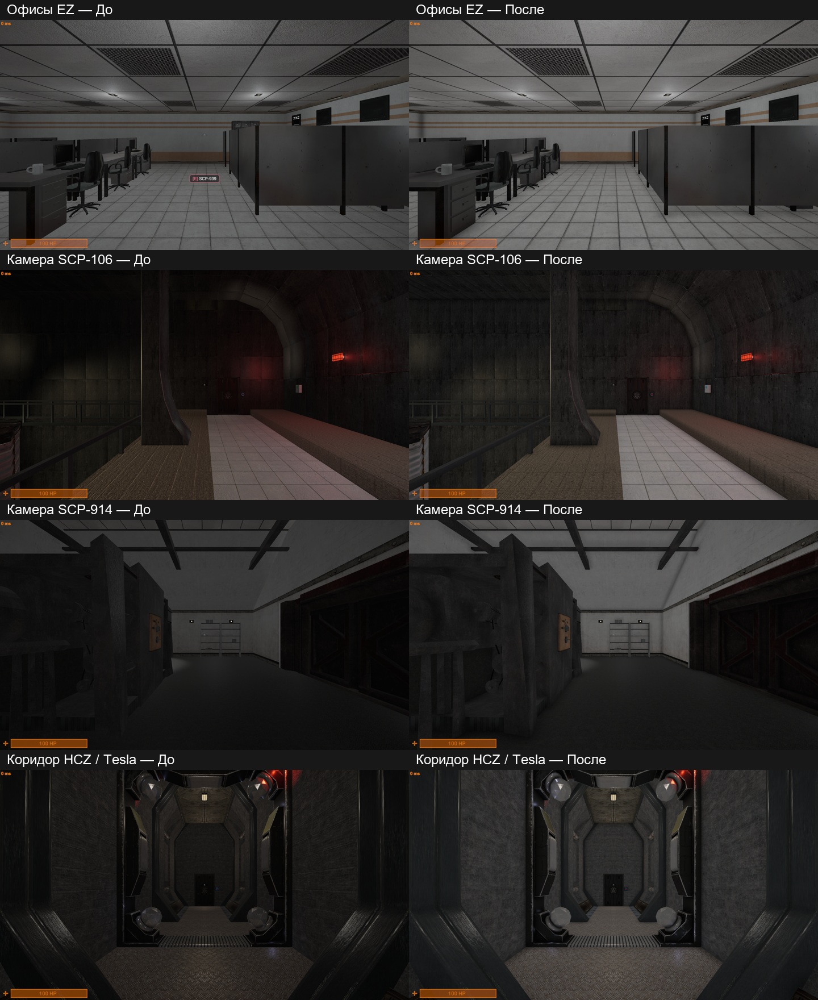

# SCP:SL CE12 — Lighting

Reversible lighting patch for **Community Edition12.0.2 / Unity6000.3 LTS / Built-in**. Room ambient fill .35, HCZ .50; shadows disabled by default, native shadow toggle and 6..12 pixel-light mapping repaired; native AO preference key and Off/MSVO/SAO restored. Native blackouts and role vision remain.

Download the .unitypackage from [Releases](https://github.com/Havermeng/scpsl-ce12-lighting/releases), import it entirely, then open **SCP → Mods → Lighting Mod Manager**. Choose optional components / Apply, or Uninstall to restore originals. Keep ScpCeLightingBackups while installed. Manual edits stop conflicting operations instead of being overwritten. You can remove the inactive installer through the manager.

Existing saved shadow/AO preferences take priority; turn shadows off in the game menu if previously enabled. The installer does not edit the user's shared registry.txt. Restart the editor if its graphics presets have not refreshed. Separate namespace/state/backup ownership allows the released character mods to coexist.

This is the accepted Built-in calibration, not proven exact HDRP parity or a performance improvement. No full game, game DLLs, scenes, textures, authentication or network changes. Unknown modified baselines are rejected. See [validation](docs/VALIDATION.md), [installation](docs/INSTALL_EN.md) and [credits](CREDITS.md).

Historical integrated-project comparison, 2026-10-25; illustrates the accepted calibration, not a fresh full gameplay run of this package.
